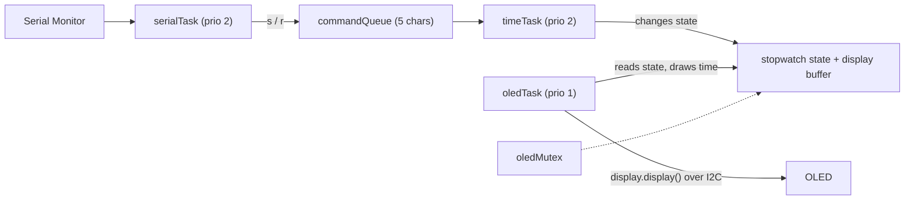

# RTOS Stopwatch/Timer System

Project for the course Real Time Systems (EFS8050-3005)
Team: Paula, Jan, Jihu

## 1. Overview

We built a stopwatch on an ESP32-S3 with an SSD1306 OLED display and FreeRTOS. The stopwatch is controlled over the Serial Monitor. The display shows the status (READY, RUNNING, PAUSED) and the elapsed time as MM:SS.t (minutes, seconds, tenths of a second).

The project is split into three FreeRTOS tasks:

- **serialTask** reads characters from the Serial Monitor and checks them.
- **timeTask** changes the stopwatch state when a command arrives.
- **oledTask** calculates the elapsed time and draws it on the display every 100 ms.

The tasks talk to each other through a queue (commands) and a mutex (shared stopwatch data and display)

## 2. Usage

Open the Serial Monitor at 115200 baud and send s or r. The line ending setting does not matter. Wiring, libraries and upload steps are in section 6.

| Command | What happens |
| --- | --- |
| s when READY | Start from zero |
| s when RUNNING | Pause, keep the time |
| s when PAUSED | Resume from the saved time |
| r | Stop and reset to zero (READY) |
| anything else | Help message in the Serial Monitor, stopwatch unchanged |

## 3. Architecture

| Task | Priority | Waits on |
| --- | --- | --- |
| serialTask | 2 | vTaskDelay 20 ms |
| timeTask | 2 | xQueueReceive (blocks until a command arrives) |
| oledTask | 1 | vTaskDelayUntil 100 ms |

All tasks are pinned to the same core (app_cpu). serialTask and timeTask have a higher priority than oledTask, so control work is never delayed by a screen refresh. The stack sizes are our own choice and we did not measure the real stack usage.

Shared data protected by oledMutex: running, startedAt, savedTicks and the display object.

## 4. The three tasks

### 4.1 serialTask

serialTask is the input part. In an endless loop it reads every available character with Serial.read(). If the character is s or r, it is sent to commandQueue with xQueueSend(). Newline and carriage return are ignored. Any other character prints a help message. After that the task sleeps for 20 ms with vTaskDelay() so other tasks can run.

Design choices:

- The task only reads and checks input. It never touches the stopwatch or the display, so it does not need the mutex.
- The queue copies the character, so the local variable command can be reused right away.
- portMAX_DELAY means that serialTask waits if the queue is full, so no command gets lost.
- The 20 ms delay avoids busy polling the serial port.
