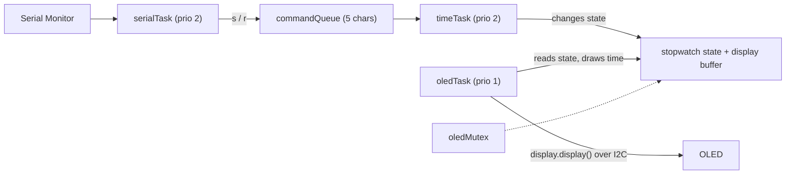

# RTOS Stopwatch/Timer System

Project for the course Real Time Systems (EFS8050-3005)
Team: Paula, Jan, Jihu

## 1. Overview

We built a stopwatch on an ESP32-S3 with an SSD1306 OLED display and FreeRTOS. The stopwatch is controlled over the Serial Monitor. The display shows the status (READY, RUNNING, PAUSED) and the elapsed time as MM:SS.t (minutes, seconds, tenths of a second).

The project is split into three FreeRTOS tasks:

- **serialTask** reads characters from the Serial Monitor and checks them.
- **timeTask** changes the stopwatch state when a command arrives.
- **oledTask** calculates the elapsed time and draws it on the display every 100 ms.

The tasks talk to each other through a queue (commands) and a mutex (shared stopwatch data and display)

## 2. Usage

Open the Serial Monitor at 115200 baud and send s or r. The line ending setting does not matter. Wiring, libraries and upload steps are in section 6.

| Command | What happens |
| --- | --- |
| s when READY | Start from zero |
| s when RUNNING | Pause, keep the time |
| s when PAUSED | Resume from the saved time |
| r | Stop and reset to zero (READY) |
| anything else | Help message in the Serial Monitor, stopwatch unchanged |

## 3. Architecture

| Task | Priority | Waits on |
| --- | --- | --- | --- |
| serialTask | 2 | vTaskDelay 20 ms |
| timeTask | 2 | xQueueReceive (blocks until a command arrives) |
| oledTask | 1 | vTaskDelayUntil 100 ms |

All tasks are pinned to the same core (app_cpu). serialTask and timeTask have a higher priority than oledTask, so control work is never delayed by a screen refresh. The stack sizes are our own choice and we did not measure the real stack usage.

Shared data protected by oledMutex: running, startedAt, savedTicks and the display object.

## 4. The three tasks

### 4.1 serialTask

serialTask is the input part. In an endless loop it reads every available character with Serial.read(). If the character is s or r, it is sent to commandQueue with xQueueSend(). Newline and carriage return are ignored. Any other character prints a help message. After that the task sleeps for 20 ms with vTaskDelay() so other tasks can run.

Design choices:

- The task only reads and checks input. It never touches the stopwatch or the display, so it does not need the mutex.
- The queue copies the character, so the local variable command can be reused right away.
- portMAX_DELAY means that serialTask waits if the queue is full, so no command gets lost.
- The 20 ms delay avoids busy polling the serial port.

### 4.2 timeTask

timeTask is the logic of our stopwatch and controls it. It waits for xQueueReceive() and only runs when a command, that means s or r is in the queue. It reads the current tick count at that point, takes oledMutex, changes the state and releases the mutex after that again.

The stopwatch uses three variables:

| Variable | Meaning |
| --- | --- |
| running | true while the stopwatch is counting |
| startedAt | tick count of the last start or resume |
| savedTicks | time collected in earlier running phases |

elapsedTicks(now) is returning the savedTicks + (now - startedAt) while running, otherwise just the savedTicks.

- Start/resume: startedAt = now; running = true; status RUNNING.
- Pause: savedTicks = elapsedTicks(now) first; then running = false. In this case the order matters because if we don't do it that way the last running part would be lost.
- Reset: running = false; savedTicks = 0; status READY.

We do not count up the variables every 100 ms. We only compare the tick counts. That is the reason that the paused time is never counted and also that a late display update can't make us lose some time. Example: If the stopwatch is running for 5 s, then we send another s to pause it. After 9 s pause we send another s to resume it. Then we let it run for 8 s. At the end the oled shows us 13 s.

## 5. Testing

We tested the stopwatch on our ESP32-S3.

| Test | Steps | Expected | Result |
| --- | --- | --- | --- |
| Startup | Reset the board. | The OLED shows READY and 00:00.0. | Pass // the OLED showed READY and 00:00.0. |
| Start | Send s. | The stopwatch starts counting. | Pass // the OLED showed RUNNING and the time increased. |
| Pause | Send s while running. | The OLED shows PAUSED and the time stays the same. | Pass // the display still showed the same time after multiple sekonds. |
| Resume | Send s while paused. | The stopwatch continues from the saved time. | Pass // counting continued from the value shown during the pause. |
| Reset while running | Send r while running. | The stopwatch returns to READY at 00:00.0. | Pass // the time returned to zero and stayed there. |
| Reset while paused | Pause the stopwatch, then send r. | The stopwatch returns to READY at 00:00.0. | Pass // the OLED showed READY and 00:00.0. |
| Invalid input | Send x, then uppercase S. | The Serial Monitor shows a help message for each input. The stopwatch stays in its current state. | Pass // both inputs produced a help message and the state stayed the same. |
| Minute change | Let the stopwatch run past 1 minute. | The display changes from 00:59.9 to 01:00.0. | Pass // the display showed 01:00.0 at the minute mark. |
| Accuracy | Run the ESP32 stopwatch alongside a phone stopwatch for about 60 s. | Both show approximately the same elapsed time. | Pass // both stopwatches showed approximately the same time after 60 s. |